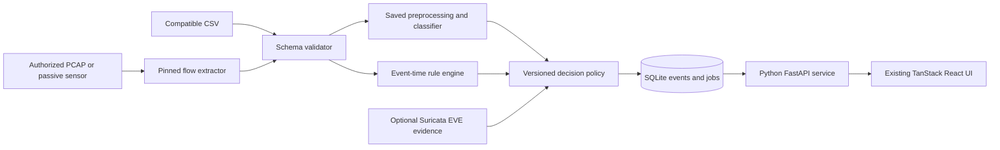

# System architecture and contracts

## Proposed topology



Keep the capture process separate from the API: only the sensor needs capture privileges. Begin with one inference worker and SQLite on a local disk; add a larger database/message broker only when measured load requires it. The existing TanStack server is an SSR wrapper, not an IDS inference service. Browser JavaScript cannot load these Python artifacts.

## Proposed repository additions

`backend/app/` for API/config/database; `src/sentinel_ids/` for schema, preprocessing, models, rules and decisions; `sensor/` for extraction adapters; `configs/` for schema/labels/rules; `tests/` for fixtures and integration tests; `artifacts/<run-id>/` for new model bundles; `data/manifests/` for splits. These directories are a target structure, not current deliverables. Keep the existing frontend location and historical artifacts intact.

## Flow contract

Separate the observation envelope from model features. Envelope: `flow_id`, `sensor_id`, `source_mode` (`demo`, `csv`, `pcap_replay`, `live`), `observed_start`, `observed_end`, `ingested_at`, optional endpoint addresses/ports/protocol, `extractor_version`, `schema_version`, source checksum/row locator and quality flags. Unknown fields are null, not synthetic IPs, current timestamps or TCP defaults.

Feature payload uses an exact ordered schema selected during training. Existing artifacts expect 76 and 77 features respectively; they are not interchangeable. Reject missing required columns, duplicate canonical names, incompatible units and nonnumeric values. The model pipeline handles permitted missing values using training-fitted statistics; reject rows beyond a documented missingness budget. Do not substitute zero for absent evidence.

Specify units per feature: duration/IAT/active/idle units must be confirmed against the chosen extractor; packet counts, byte counts, packets/second and bytes/second are distinct. Define forward direction, population/sample standard deviation conventions, retransmission handling, flow timeout, idle timeout, single-packet/zero-duration behavior, TCP teardown and partial capture behavior. Header name similarity does not establish parity.

## Proposed API

| Endpoint | Request / response | Gate |
|---|---|---|
| `GET /api/v1/health` | API/model/sensor state, heartbeat and drops | Never infer sensor health from API uptime |
| `GET /api/v1/models` | Approved model IDs, schema, metrics, limitations | Registry data, not arbitrary filesystem paths |
| `POST /api/v1/analysis-jobs` | Bounded CSV upload, model ID, mode; returns job ID (202) | File/type/size/schema checks, generated storage name |
| `GET /api/v1/analysis-jobs/{id}` | Queued/running/completed/partial/failed, counts/errors | Structured errors without stack disclosure |
| `GET /api/v1/flows` | Cursor/time/filter query | Pagination and stable ordering |
| `GET /api/v1/alerts` | Filtered alerts with evidence and provenance | Role-scoped results |
| `PATCH /api/v1/alerts/{id}` | Disposition/note/expected revision | Optimistic concurrency, audit record |
| `GET/PUT /api/v1/rules` | Versioned rule configuration | Admin validation and history |
| `GET /api/v1/events` | Optional SSE with event ID/cursor | Reconnect and replay deduplication |

Start UI refresh with polling; add SSE after job/history behavior works. The UI's existing 20 MB/20,000-flow rules-only limit remains explicit. Large training files stay on disk and are processed by CLI; do not upload the whole dataset into the browser.

## Decision response example

```json
{
  "flow_id": "sensor-a:run-17:42",
  "source_mode": "pcap_replay",
  "model_id": "rf-example-v1",
  "schema_version": "flow-v1",
  "ml_label": "BENIGN",
  "ml_attack_score": 0.18,
  "rules": [{"id": "scan-window-v1", "status": "matched", "unique_ports": 27}],
  "decision": "review",
  "decision_reason": "validated_rule_override",
  "severity": "medium",
  "policy_version": "policy-v1"
}
```

Illustrative contract only. Scores are not calibrated probabilities unless a calibration procedure is recorded. Do not label this example as a measured detection.

## Persistence and deployment

Tables: models, analysis_jobs, flows, detections, alerts, alert_actions, rule_versions and sensor_health. Keep detections immutable; alert actions are append-only with an actor. Use unique sensor/run/flow keys for idempotent ingestion and indexes on event time, source and alert status. Persist model/schema/policy versions on each detection. Put a hard retention/size budget on flow storage and backups; SQLite writes are serialized through the worker/repository layer.

For pilot deployment, place a passive Linux sensor on a verified SPAN/TAP or virtual switch mirror. Windows is suitable for the UI and offline model work; a hosted UI or WSL installation alone does not create network visibility. A device on switched Ethernet normally cannot see all other devices' traffic without mirroring. Capture both directions when the feature schema requires them. Restrict sensor credentials to ingestion, rotate them, and never expose a privileged packet parser directly to the public internet.

Do not assume Suricata/Zeek flow logs contain the CIC feature vector. Suricata EVE can provide separate evidence; either prove adapter parity or retrain on features the chosen production sensor actually emits.
